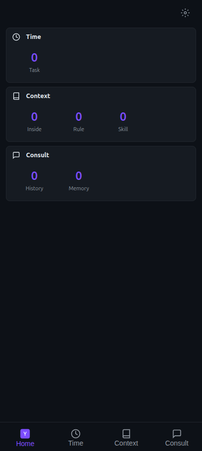
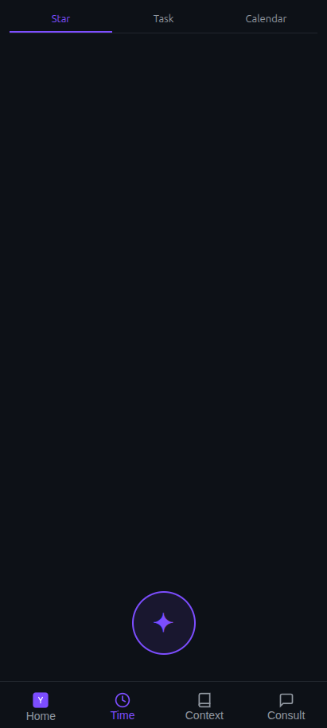
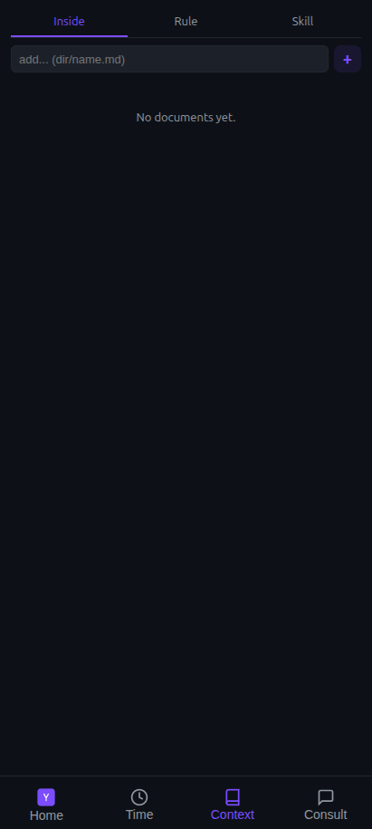
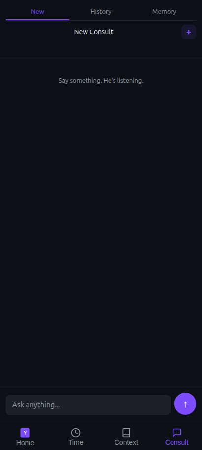
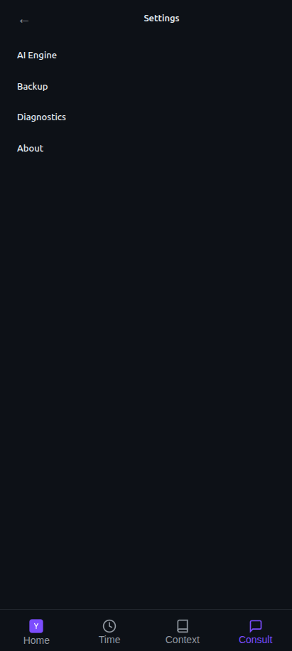

<div align="center">

# openyou

**A parallel version of you — with superpowers.**

It knows everything about you, so it can give you better advice. Focused on your career, and covering learning, information and everyday life.

*Go daemon + Kotlin WebView shell · DeepSeek API*


[中文](README.md) · [VISION](docs/VISION.md) · [SPEC](docs/SPEC.md) · [Quick Start](#quick-start) · [Configuration](#configuration) · [License](#license)

</div>

---

## About

openyou is not another chatbot. It is your **mirror, strategist and right hand**:

- **Your data is its identity**: its intelligence comes from your data (resume, people, rules, skills, memories), not from the model. Without your context, it is no longer you.
- **It is the subject; chat is just an interface**: Context and memory are the core system; conversation is only one way it talks to you.
- **It is proactive, you are passive**: opening the app shows what *it* found, not an empty input box.
- **It remembers; you never repeat yourself**: say one word and it knows the full context.
- **It follows up; you give feedback**: give advice → ask for results → correct its understanding.
- **It is always on**: background processing and push, no need to open the app.

See [VISION.md](docs/VISION.md) for the full philosophy.

## Features

- **Brain Trust**: multiple skills analyze a question in parallel — cross-checked, conflicts detected, results synthesized.
- **On-demand retrieval**: rules are always loaded; data (resume/question bank/people) is injected by `##` section chunks — a 300k-character question bank only brings the relevant questions; a matched skill is injected in full.
- **Memory system**: auto-extracts key facts after each conversation, per-type confidence thresholds, async background processing, periodic decay.
- **Incremental refresh**: manual edits use single-file O(1) refresh; direct file edits are detected by mtime fingerprint — no restart needed.
- **Privacy by design**: person-name pseudonymization, field-level AES-256-GCM encryption for the API key, app lock (fingerprint + pattern), `FLAG_SECURE` anti-screenshot.
- **Local-first**: single-machine SQLite storage; the daemon listens on `127.0.0.1` only.

## Screenshots

| Home | Time & Tasks | Context |
|:---:|:---:|:---:|
|  |  |  |
| **Consult** | **Settings** | |
|  |  | |

> Screenshots are from a local empty-data instance; once you add your context, the dashboard surfaces what it found — pending tasks, health and suggestions.

## Architecture

```
┌─ UI Layer (WebView SPA)───────────────────────────────────┐
│  web/ sources → build.py → index.html (single-file,       │
│  CSS inlined) · Home · Context · Time · Consult · Settings│
└────────────┬──────────────────────────────────────────────┘
             │ WebSocket (/ws) + HTTP REST (:8765)
┌────────────▼──────────────────────────────────────────────┘
┌─ Go daemon (:8765)────────────────────────────────────────┐
│  Workers: Star 6h · health 24h · memory decay 24h         │
│  Brain Trust: ≤5 sub-agents → conflicts → synthesis       │
│  MaskingClient (pseudonymize) → DeepSeek SSE              │
│  Storage: SQLite (api_key AES-256-GCM encrypted)          │
└────────────┬──────────────────────────────────────────────┘
             │ JNI (cgo)
┌────────────▼──────────────────────────────────────────────┘
┌─ Kotlin Android Shell─────────────────────────────────────┐
│  WebView · ForegroundService · Notification · App Lock    │
└───────────────────────────────────────────────────────────┘
```

Tech stack:

| Layer | Tech |
| --- | --- |
| UI | HTML/CSS/JS SPA (`web/` sources, merged to a single file at build) |
| Brain | Go 1.22+ + cgo → `.so` (arm64 + x86_64) |
| Shell | Kotlin + WebView (minSdk 31) |
| Storage | SQLite (mattn/go-sqlite3) |
| LLM | DeepSeek SSE streaming (OpenAI-compatible) |
| Crypto | AES-256-GCM field-level |

## Project Structure

```
openyou/
├── android/              # Kotlin Android shell (WebView, foreground service, app lock)
├── daemon/               # Go daemon → .so via cgo + JNI
│   └── internal/
│       ├── ai/           # agent skill types · llm client · thinktank (brain trust)
│       ├── infra/        # db/config/crypto/privacy/notify/bridge/tool
│       ├── server/       # HTTP routes & handlers (REST/SSE/WS, Web UI included)
│       ├── service/      # background workers · matcher (retrieval) · importer
│       └── store/        # consult/memory/task SQLite stores
├── docs/                 # VISION.md (constitution) · SPEC.md (functional spec)
├── scripts/              # build.sh · test_e2e.sh · test_apk.sh ...
├── userdata.example/     # open-source skeleton + openyou.example.jsonc
├── userdata/             # your private context (gitignored, never published)
└── web/                  # Web UI sources (CSS/HTML/JS) + logo.svg
```

## Quick Start

### Build the APK

Prerequisites: Go 1.22+, Android NDK 27.0+, Gradle + Android SDK.

```bash
bash scripts/build.sh
```

Output: `openyou-v<version>.apk` in the project root. The version auto-increments; the source of truth is `web/js/core/state.js`.

### Run the daemon locally (Linux, no Android)

```bash
cd daemon && go build -o daemon ./cmd/daemon/ && ./daemon &
curl http://127.0.0.1:8765/api/health   # {"status":"ok"}
```

### Tests

```bash
bash scripts/test_e2e.sh           # built-in fake LLM, no key required
bash scripts/test_e2e.sh --live    # real DeepSeek (needs an API key)
bash scripts/test_apk.sh           # 6-layer APK test
```

## Configuration

LLM configuration, in descending priority:

1. **App Settings page** (`PUT /api/config`, persisted encrypted in SQLite)
2. **`userdata/openyou.json` / `userdata/openyou.jsonc`** (read at daemon startup; applies only when the key is empty; supports `//` comments)
3. Built-in defaults: `base_url=https://api.deepseek.com/v1`, `model=deepseek-v4-pro`, `api_key` empty

Reference template: [`userdata.example/openyou.example.jsonc`](userdata.example/openyou.example.jsonc)

```jsonc
{
  // DeepSeek (default)
  "api_key": "sk-your-deepseek-key",
  "base_url": "https://api.deepseek.com/v1",
  "model": "deepseek-v4-pro",

  // or OpenAI
  // "api_key": "sk-your-openai-key",
  // "base_url": "https://api.openai.com/v1",
  // "model": "gpt-4o",

  "max_tokens": 4096,
  "temperature": 0.7,
  // "privacy_mode": "balanced"   // balanced=mask names | trust=no masking
}
```

> The API key is never overwritten: a value set in the Settings page always wins over the file; `GET /api/config` returns only a mask (last 4 chars); the key never enters git, backups, or logs.

## Data & Privacy

- **`userdata/` is your private data** (resume, people, rules, skills, memories) — excluded by `.gitignore`, **never published**. Open-source clones only get the `userdata.example/` skeleton.
- Your context stays fully local (SQLite + files); the daemon listens on `127.0.0.1` only; all LLM calls pass through person-name pseudonymization.

## Documentation

- [VISION.md](docs/VISION.md) — constitution: who it is, its principles
- [SPEC.md](docs/SPEC.md) — functional spec and implementation
- [AGENTS.md](AGENTS.md) — repository guide for AI agents and developers

## Contributing

See [CONTRIBUTING.md](CONTRIBUTING.md). For security issues, see [SECURITY.md](SECURITY.md).

## License

[MIT](LICENSE) © 2026 hezhiyong
