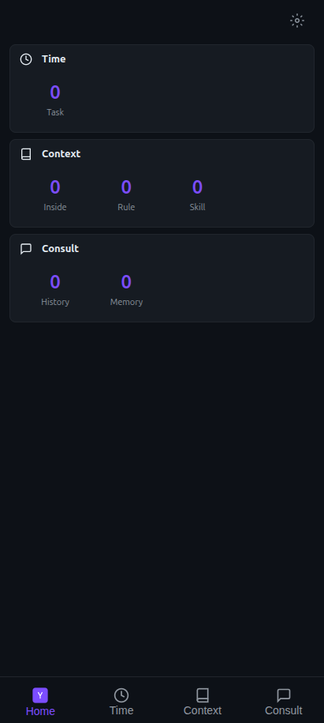
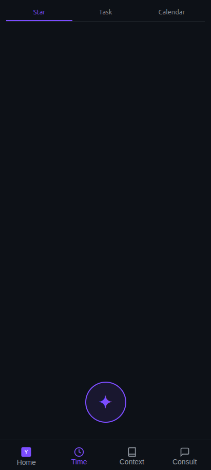
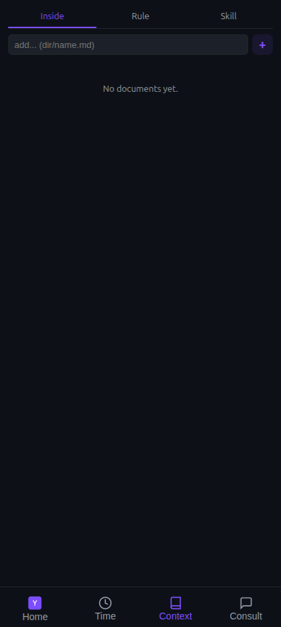
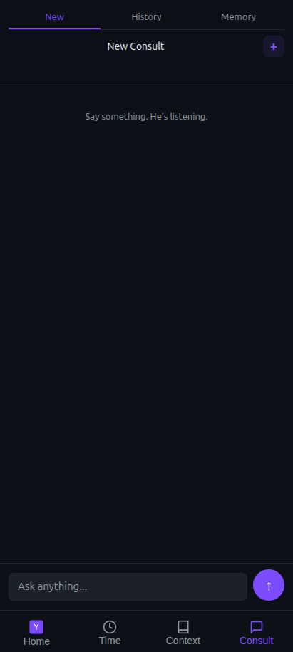
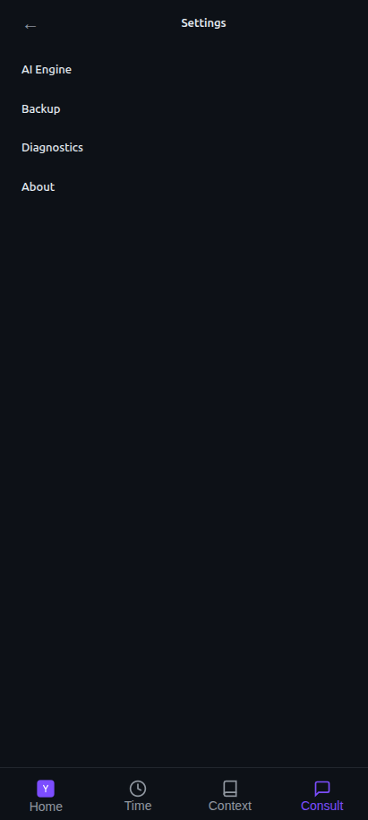

<div align="center">

# openyou

**平行版本的你——有超能力的 openyou。**

知道你的全部信息，所以能给你更好的建议。职场为主，也涵盖学习、信息、生活的各方面。

*Go daemon + Kotlin WebView shell，DeepSeek API*


[English](README.en.md) · [产品定位](docs/VISION.md) · [功能规格](docs/SPEC.md) · [快速上手](#快速上手) · [配置](#配置) · [License](#license)

</div>

---

## 简介

openyou 不是又一个聊天机器人。他是你的**镜子、军师、臂膀**：

- **数据是身份**：他的智慧来自你的数据（简历、人物、规则、技能、记忆），不是来自模型。
  抽掉你的 Context，他不再是你。
- **他是主体，chat 是接口**：Context 与记忆是核心系统，对话只是他的一种输出方式。
- **他主动，你被动**：打开 app 看到的是"他发现的"，不是空白输入框。
- **他记得，你不用复述**：你说一个词，他知道全部上下文。
- **他追问，你反馈**：给了建议 → 问结果 → 修正认知，形成回环。
- **他一直在**：后台持续处理、主动推送，不需要你打开 app。

完整理念见 [VISION.md](docs/VISION.md)。

## 特性

- **智囊团（Brain Trust）**：多个技能并行分析同一问题，交叉验证、冲突检测、综合输出。
- **按需检索**：规则全量加载；资料（简历/题库/人物）按 `##` 章节检索注入，30 万字题库一次只带相关几题；技能命中后整篇注入。
- **记忆系统**：对话后自动提取关键信息，分类型置信度阈值，异步队列后台处理，定期衰减。
- **增量刷新**：手动增删改走单文件 O(1) 刷新；直接改文件由 mtime 指纹自动感知，无需重启。
- **隐私设计**：人名脱敏（Pseudonymizer）、api_key 字段级 AES-256-GCM 加密、App 锁（指纹 + 九点图案）、`FLAG_SECURE` 防截屏。
- **本地优先**：SQLite 单机存储，daemon 仅监听 `127.0.0.1`。

## 截图

| Home 看板 | Time & Tasks | Context |
|:---:|:---:|:---:|
|  |  |  |
| **Consult** | **Settings** | |
|  |  | |

> 截图来自本地空数据实例；接入你的 Context 后，看板会展示他发现的待办、健康度与建议。

## 架构

```
┌─ UI Layer (WebView SPA)───────────────────────────────────┐
│  web/ sources → build.py → index.html (single-file,       │
│  CSS inlined) · Home · Context · Time · Consult · Settings│
└────────────┬──────────────────────────────────────────────┘
             │ WebSocket (/ws) + HTTP REST (:8765)
┌────────────▼──────────────────────────────────────────────┘
┌─ Go daemon (:8765)────────────────────────────────────────┐
│  Workers: Star 6h · health 24h · memory decay 24h         │
│  Brain Trust: ≤5 sub-agents → conflicts → synthesis       │
│  MaskingClient (pseudonymize) → DeepSeek SSE              │
│  Storage: SQLite (api_key AES-256-GCM encrypted)          │
└────────────┬──────────────────────────────────────────────┘
             │ JNI (cgo)
┌────────────▼──────────────────────────────────────────────┘
┌─ Kotlin Android Shell─────────────────────────────────────┐
│  WebView · ForegroundService · Notification · App Lock    │
└───────────────────────────────────────────────────────────┘
```

技术栈：

| 层 | 技术 |
| --- | --- |
| 界面 | HTML/CSS/JS SPA（`web/` 多文件源码，构建合并为单文件） |
| 大脑 | Go 1.22+ + cgo → `.so`（arm64 + x86_64） |
| 壳 | Kotlin + WebView（minSdk 31） |
| 存储 | SQLite（mattn/go-sqlite3） |
| LLM | DeepSeek SSE streaming（OpenAI-compatible） |
| 加密 | AES-256-GCM 字段级 |

## 项目结构

```
openyou/
├── android/              # Kotlin Android shell (WebView, foreground service, app lock)
├── daemon/               # Go daemon → .so via cgo + JNI
│   └── internal/
│       ├── ai/           # agent skill types · llm client · thinktank (brain trust)
│       ├── infra/        # db/config/crypto/privacy/notify/bridge/tool
│       ├── server/       # HTTP routes & handlers (REST/SSE/WS, Web UI included)
│       ├── service/      # background workers · matcher (retrieval) · importer
│       └── store/        # consult/memory/task SQLite stores
├── docs/                 # VISION.md (constitution) · SPEC.md (functional spec)
├── scripts/              # build.sh · test_e2e.sh · test_apk.sh ...
├── userdata.example/     # open-source skeleton + openyou.example.jsonc
├── userdata/             # your private context (gitignored, never published)
└── web/                  # Web UI sources (CSS/HTML/JS) + logo.svg
```

## 快速上手

### 构建 APK

前置：Go 1.22+、Android NDK 27.0+、Gradle + Android SDK。

```bash
bash scripts/build.sh
```

产物 `openyou-v<版本>.apk` 位于项目根目录。版本号自动递增，源在 `web/js/core/state.js`。

### 本地运行 daemon（Linux，无需 Android）

```bash
cd daemon && go build -o daemon ./cmd/daemon/ && ./daemon &
curl http://127.0.0.1:8765/api/health   # {"status":"ok"}
```

### 测试

```bash
bash scripts/test_e2e.sh           # built-in fake LLM, no key required
bash scripts/test_e2e.sh --live    # real DeepSeek (needs an API key)
bash scripts/test_apk.sh           # 6-layer APK test
```

## 配置

LLM 配置按优先级从高到低：

1. **App 设置页填写**（`PUT /api/config`，SQLite 加密持久化）
2. **`userdata/openyou.json` / `userdata/openyou.jsonc`**（daemon 启动时读取，仅当对应项为空时生效，支持 `//` 注释）
3. 内置默认：`base_url=https://api.deepseek.com/v1`、`model=deepseek-v4-pro`、`api_key` 为空

参考模板见 [`userdata.example/openyou.example.jsonc`](userdata.example/openyou.example.jsonc)：

```jsonc
{
  // DeepSeek (default)
  "api_key": "sk-your-deepseek-key",
  "base_url": "https://api.deepseek.com/v1",
  "model": "deepseek-v4-pro",

  // or OpenAI
  // "api_key": "sk-your-openai-key",
  // "base_url": "https://api.openai.com/v1",
  // "model": "gpt-4o",

  "max_tokens": 4096,
  "temperature": 0.7,
  // "privacy_mode": "balanced"   // balanced=mask names | trust=no masking
}
```

> API key 不会被覆盖：设置页已填的值永远优先于文件；`GET /api/config` 只返回掩码（末 4 位）；api_key 不进入 git、备份与日志。

## 数据与隐私

- **`userdata/` 是你的私有数据**（简历、人物、规则、技能、记忆），已被 `.gitignore` 排除，**不会随仓库上传**。
  开源克隆得到的只是 `userdata.example/` 空骨架。
- 你的 Context 全部本地存储（SQLite + 文件），daemon 只监听 `127.0.0.1`，LLM 调用统一经过人名脱敏。

## 相关文档

- [VISION.md](docs/VISION.md) — 宪法：他是谁、他的原则
- [SPEC.md](docs/SPEC.md) — 功能规格与技术实现
- [AGENTS.md](AGENTS.md) — 面向 AI agent 与开发者的仓库导航

## 贡献

见 [CONTRIBUTING.md](CONTRIBUTING.md)。安全问题请参考 [SECURITY.md](SECURITY.md)。

## License

[MIT](LICENSE) © 2026 hezhiyong
